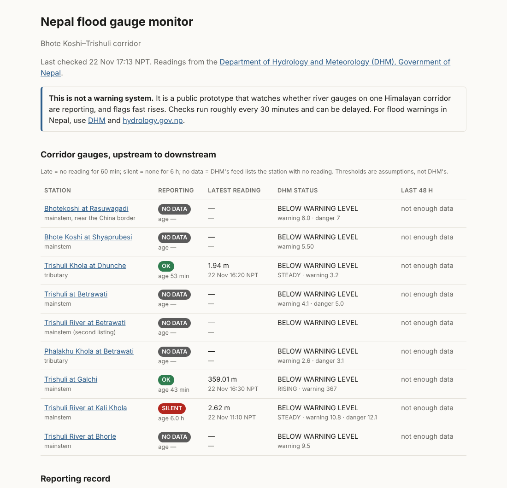

# Nepal flood gauge monitor

A public monitoring prototype for the Bhote Koshi–Trishuli river corridor in Nepal, hit by flash floods in July 2025 and August 2026. Every 30 minutes it reads the live gauge feed published by Nepal's Department of Hydrology and Meteorology (DHM), checks whether each gauge on the corridor is still reporting, flags fast rises in water level, and publishes the result as a status page.

**Status page:** https://groxburgh.github.io/nepal-flood-gauge-monitor/

[](https://groxburgh.github.io/nepal-flood-gauge-monitor/)

This is not a warning system and must not be relied on as one. Checks run on GitHub's scheduler, which can delay or skip runs, and the thresholds are uncalibrated. For flood warnings in Nepal, use [DHM](https://www.dhm.gov.np/) and [hydrology.gov.np](https://hydrology.gov.np/).

The monitor runs unattended from 22 November 2026 to **21 January 2027**. After that it stops requesting data and the status page becomes a labelled archive. The end date is `END_AT` in [`monitor/config.py`](monitor/config.py).

## Why gauge silence matters

On 26 August 2026 an ice-rock avalanche from the north face of Langtang Lirung became a debris flow in the Lhende Khola and travelled down the Bhote Koshi into the Trishuli. According to the International Centre for Integrated Mountain Development's page "Kyirong-Rasuwa Flood 2026 | Nepal-China Cryosphere Risk" (published 28 August 2026, updated 14 October 2026), the Rasuwagadhi gauge showed no rise before it was destroyed, and no warning reached Rasuwagadhi or Timure.

The Flood Forecasting Division's technical report, as reported in OnlineKhabar's "Technical report details Bhotekoshi flood's journey from Tibet to Devghat" (27 August 2026), sets out the morning:

| Time (NPT) | Event |
|---|---|
| 08:37 | Seismic signal recorded |
| 08:50 | Bhotekoshi–Syafrubesi gauge stops transmitting (last reading 1.62 m at 08:40, warning level 6 m) |
| 09:00 | Flood Forecasting Division hears of the flood by telephone from the district office and Betrawati station staff |
| 09:15 | First SMS warnings go out, 679,295 messages along the corridor |
| 09:20 | Betrawati gauge stops transmitting |

The first instrumental sign of the flood on Nepal's side was a gauge falling silent, and the river level it last reported was calm. A gauge that stops reporting may have a technical fault, or it may have been hit by the flood it was there to measure. DHM's public feed does not distinguish between the two, and silence is only noticed if someone happens to look. This project checks for it on a schedule and keeps a public record.

## Research behind this

The reasoning this monitor rests on is in [`docs/`](docs/): seven research runs written 28–29 August 2026 on why the warning chain failed, the method behind them, an adversarial review that corrected a significant error in their own arithmetic, and the pre-build specification. The casualty figures in that research are August snapshots and have been superseded; see [`docs/ADDENDUM-2026-11.md`](docs/ADDENDUM-2026-11.md).

The corrected error bears directly on what this monitor is for. The research first estimated that a dead-station alarm would have bought about 20 minutes of warning on 26 August. Recomputed against the measured 5 to 15 minute lag in DHM's data, the figure is between 4 minutes worse and 11 minutes better than the SMS alerts that actually went out ([`docs/review/review-adjudication.md`](docs/review/review-adjudication.md)). Measured against when DHM actually learned of the flood, by telephone, the alarm comes out worse in every scenario the review tested except the most favourable one. The case that survives is about events nobody witnesses (at night, in the off season, in empty upper catchments), and about knowing at all times which gauges a warning would depend on.

## What it does

| Check | Rule | Why |
|---|---|---|
| Reporting | OK if the latest reading is under 60 min old; **late** after 60 min; **silent** after 6 h; **no data** if DHM lists the station with no reading | Gauges that report every 5 to 10 minutes and then stop are a signal in themselves |
| Rapid rise | Flag a rise of 0.5 m or more within 60 min | A placeholder for "the river is doing something unusual" |
| DHM status | Shows DHM's own warning/danger status and trend | So the page never contradicts the official source silently |

It watches nine corridor stations from Rasuwagadi on the China border down to Bhorle, and also counts how many of DHM's ~330 listed river stations are reporting at each check.

All thresholds live in [`monitor/config.py`](monitor/config.py). They are assumptions: the 5 to 10 minute reporting cadence is what the feed shows at working stations, not a documented DHM figure, and the rise threshold has not been tested against any station's flood record.

## What the first run found

The first check (22 November 2026, about three months after the flood) recorded no current reading for the mainstem gauges at Rasuwagadi, Shyaprubesi and Betrawati. Setopati's "Government installs VSAT camera in Timure to monitor Bhotekoshi after flood" (3 September 2026) reports that these three stations were swept away, could not be restored immediately, and were replaced for now by a camera at Timure watched from Kathmandu. Three months on, DHM's feed still has no readings from them. In the same feed, DHM's status field still read "BELOW WARNING LEVEL" for each of those stations, so anyone reading the status alone would see a calm river rather than a missing gauge. Nationally, roughly half of the listed river stations had no reading in the feed. Some of those may be seasonal, manual or retired stations rather than failures; the feed does not say which.

## How it works

```
GitHub Actions (every 30 min)
  └─ monitor/fetch.py   read DHM's public flood-monitoring page, keep whitelisted fields only
  └─ monitor/checks.py  silence + rapid-rise checks
  └─ monitor/store.py   append to CSV history on the `data` branch
  └─ monitor/site.py    render a static page, deploy to GitHub Pages
```

- **Source.** DHM's [flood monitoring page](https://www.dhm.gov.np/hydrology/floodMonitoring) embeds the latest reading for every river-watch station. `tools/probe_dhm.py` is the headless-browser probe used to find it.
- **Privacy.** DHM's feed also contains station staff names and phone numbers. The parser keeps a fixed whitelist of fields, and a test checks that nothing else gets through.
- **Load on DHM.** One page request every 30 minutes, with a user agent that links back here.
- **History.** Raw readings, national counts and state changes are plain CSV on the [`data`](../../tree/data) branch, so the main branch history stays readable.
- **Failure.** Requests to DHM are retried three times. If the page still cannot be read, or changes shape, the check logs a `SOURCE ERROR` and the status page says so while keeping the last good data. A source error is shown as a warning rather than a failed run, so an unattended project does not send an email every 30 minutes. Errors in this project's own code still fail the run.
- **Reporting record.** Each check also stores every corridor gauge's state, so the page shows what share of checks found each gauge reporting on time. When monitoring ends, that table is the project's result.
- **End date.** After `END_AT`, the next run renders the archive page and writes an `ARCHIVED` marker to the `data` branch. Every later run stops at its first step.

Run it locally:

```bash
pip install -r requirements.txt -r requirements-dev.txt
python -m pytest -q
python -m monitor.run --store store --site site      # writes site/index.html
```

## Limits

- GitHub's scheduler is best-effort, and GitHub disables scheduled workflows in public repositories after 60 days without repository activity, which may stop runs before the end date.
- A 30-minute check is far too slow to warn anyone about a surge that, by the accounts above, crossed from the border to Betrawati in well under an hour.
- The rapid-rise check needs two readings inside its window, so it says nothing about a station that is already silent.
- The page shows what DHM publishes. It has no independent sensors.

## Data and licence

River data is published by the Department of Hydrology and Meteorology, Government of Nepal. Code is MIT licensed.
